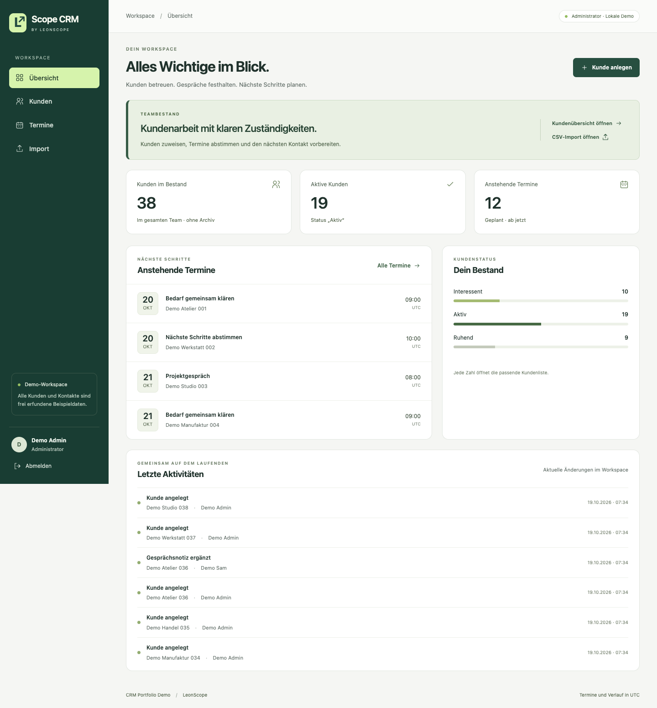
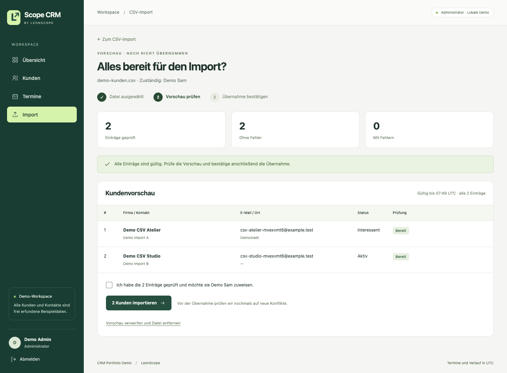
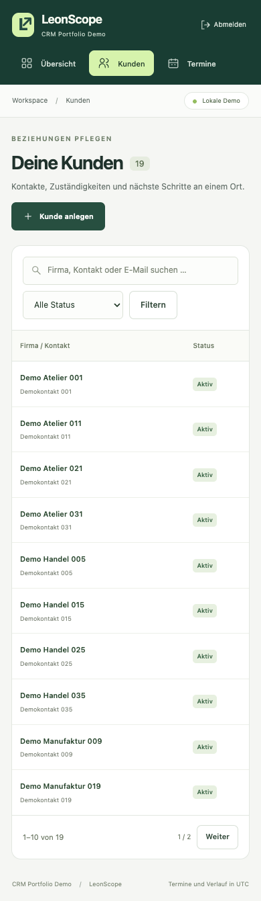
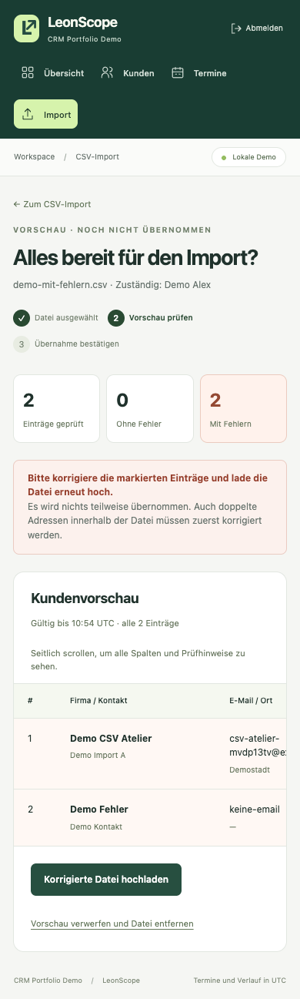

# Scope CRM

### Customers, appointments and responsibilities in one place

**Business application · Laravel · Local portfolio demo**

[Deutsch](README.de.md) · [Case study](docs/CASE-STUDY.md) · [Verification](docs/VERIFICATION.md)

Scope CRM is a local demo for a small team managing customer relationships. Each customer has an assigned team member, conversation notes and appointments. An activity history records changes. The project was developed with AI assistance and uses fictional data throughout.

## A working day in the CRM

| Task | How it works |
| :--- | :--- |
| Prepare a conversation | Find the customer, review notes and see upcoming appointments. |
| Assign responsibility | Administrators manage the team view; employees work with their assigned customers. The server enforces access. |
| Keep a useful record | Customer and appointment changes are stored together with their history entries. |
| Bring in new customers | Upload a CSV, inspect every row and confirm before anything is imported. |

The overview shows upcoming appointments and recent changes. Administrators see the whole team’s customer list and can open the CSV import from there. Employees see the customers assigned to them.

## Import with a review step

**Upload → validation and preview → explicit confirmation.** Invalid imports create no customers. Checks cover duplicates, archived records, ownership, expired previews and changed files; imports add new records rather than updating existing ones.

<strong>Phone views</strong> — customer search and import errors

<table><tr>
<td valign="top"><strong>Customer list</strong> </td>
<td valign="top"><strong>Import validation</strong> </td>
</tr></table>

## Technology and tests

The application uses **Laravel 13, PHP 8.4, Blade, SQLite and Vite**. Initial setup creates 40 fictional customers and three local accounts.

On 19 October 2026, **53 application tests with 430 assertions and four browser workflows passed again**. The [test report](docs/VERIFICATION.md) covers the environment, tested cases and earlier clean installation on 18 October.

I set the direction and scope of the demo and guided its revisions. Codex generated the code, interface, sample data and tests, and ran the documented checks. AI was used during development; the CRM itself does not use an AI model.

## What is published here

This repository contains **the project write-up and screenshots**. The application runs locally; its source, credentials, database and installable packages remain private. There is no public demo or GitHub application test run. The demo was built separately from my earlier client work and contains none of that client’s code or business data.

No open-source license, Creative Commons license or general reuse permission is granted for the original material. See the [rights notice](RIGHTS.md) for details.

[Case study and interview walkthrough](docs/CASE-STUDY.md) · [Verification](docs/VERIFICATION.md) · [LeonScope](https://github.com/LeonScope)
